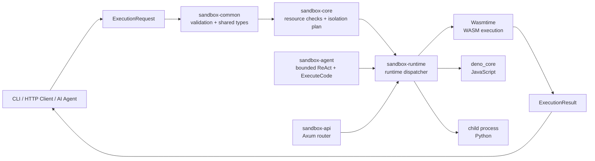

# CortexEnv

**CortexEnv** is a Rust workspace for building an observable execution environment for AI-generated and user-submitted code. Requests are validated first, resource policies are explicit, and language runtimes are exposed through focused adapters. Operating-system isolation is still under development; do not use the current runtimes as a hostile-code security boundary.

> **Current status:** WASM, JavaScript, and Python execution adapters are available, along with shared request/result types, bounded API admission and job history, request IDs, API-key/JWT authentication, in-memory per-principal request/concurrency quotas, principal-scoped async job results, a provider-neutral chat-model interface with an OpenAI-compatible client, a bounded ReAct code-execution loop, and the CLI smoke test. JavaScript runs in `deno_core`; Python requires an installed interpreter and runs as a child process with best-effort process-group cleanup on Linux targets that support `waitid(WNOWAIT)`. Durable usage accounting, stateful agent sessions, end-to-end self-healing coverage, and OpenTelemetry export remain pending. Linux namespaces, seccomp, capability dropping, filesystem/network isolation, and containment of descendants that escape the process group are not enforced; the adapters must not be treated as secure isolation from hostile code.

**Recent security progress:** authenticated async jobs are owned by their submitting principal. Status polling, WebSocket streaming, and cross-principal ID collisions do not disclose another principal's job; the static API key intentionally represents one shared principal. These ownership and quota records are in memory only and are lost on restart.

**Recent runtime progress:** WASM deadlines now use a per-execution Wasmtime engine and repeated epoch ticks, preventing a deadline tick during module compilation from leaving an infinite guest loop running and preventing one execution's timeout from interrupting another.

**Recent process supervision progress:** On Linux targets with `waitid(WNOWAIT)` support, Python runs in its own process group; timeout and leader exit trigger cleanup of remaining members before the leader is reaped. Descendants that escape the group and OS resource/network isolation remain unsupported.

**Next roadmap priorities:** build a fail-closed child supervisor before claiming hostile-code isolation; then add durable/distributed quota accounting, OpenTelemetry export, stateful agent sessions, and end-to-end self-healing coverage. A warm worker pool also remains on the TODO roadmap.

Repository: <https://github.com/hidecard/CortexEnv>

## What CortexEnv does

The project accepts an execution request containing a language, program payload, resource limits, and a network policy. The request is validated by `sandbox-common` and `sandbox-core`. The selected runtime then executes the program and returns a structured result containing an ID, exit status, stdout, stderr, timeout state, duration, and completion timestamp.

The runtime supports WebAssembly through Wasmtime, JavaScript through `deno_core`, and Python through a child interpreter process. WASM requests contain hexadecimal module bytes; JavaScript and Python requests contain source text. The CLI remains a WASM-only smoke-test tool, while the API and Rust runtime dispatcher can execute all three languages. Python requires `python3` (or `python` on Windows); `CORTEXENV_PYTHON` can select another interpreter executable.

## Architecture



### Execution flow

1. A client creates an `ExecutionRequest` with a UUID, language, source/module payload, resource limits, and network policy.
2. `sandbox-common` rejects empty or oversized code and validates timeout, memory, process, file-descriptor, and output ceilings.
3. `sandbox-core` validates and records an explicit isolation plan. OS-level network and filesystem enforcement is not complete; notably, Python `network: deny` is not currently enforced by the host.
4. `sandbox-runtime` dispatches to the selected runtime. WASM bytes are supplied as hexadecimal text; JavaScript and Python are supplied as source text.
5. The runtime captures bounded output and returns a structured `ExecutionResult`; WASM and the language adapters enforce execution deadlines, but Python's child process is not yet constrained by OS memory, network, or process-tree isolation.
6. The API or CLI serializes the result as JSON for the caller.

## Workspace layout

| Component | Responsibility |
| --- | --- |
| `sandbox-common` | Shared request/result/configuration types, errors, language and network policy enums, and bounded resource validation. |
| `sandbox-core` | Execution validation, tracing hook, fail-closed isolation plan, and per-execution temporary workspaces with traversal-safe path resolution. |
| `sandbox-runtime` | Runtime dispatch for Wasmtime, `deno_core` JavaScript, and Python child execution with Linux process-group cleanup where `waitid(WNOWAIT)` is supported. |
| `sandbox-api` | Axum router and server with `GET /health`, synchronous `POST /v1/execute`, asynchronous `POST /v1/execute/async`, and `GET /v1/executions/:id`. |
| `sandbox-agent` | Provider-neutral `ExecuteCode` and `ChatModel` traits, an OpenAI-compatible chat-completions client, and a bounded ReAct execution loop. |
| `sandbox-cli` | Local command-line runner, distributed as the `cortexenv` executable. |
| `CortexEnv` root crate | Workspace marker and project metadata. |

## Language-model client

`sandbox-agent` defines a provider-neutral `ChatModel` trait and ships an OpenAI Chat Completions-compatible HTTP client. Configure the API key in the host application rather than hard-coding it; for example:

```rust
use sandbox_agent::{
    llm::OpenAiCompatibleClient,
    react::{ReActAgent, ReActConfig},
    Runtime, RuntimeTool,
};
use std::sync::Arc;

async fn run_agent() -> Result<(), Box<dyn std::error::Error>> {
    let model = OpenAiCompatibleClient::new(
        "https://api.openai.com/v1",
        std::env::var("CORTEXENV_LLM_API_KEY")?,
        "your-model-name",
    )?;
    let agent = ReActAgent::new(
        model,
        RuntimeTool::new(Arc::new(Runtime::default())),
        ReActConfig::default(),
    );
    let outcome = agent.run("Write and run a short Python greeting.").await?;
    println!("{}", outcome.answer);
    Ok(())
}
```

The adapter returns plain assistant text. `ReActAgent` interprets strict JSON `execute`/`final` actions, uses `ExecuteCode`, and can perform at most 10 sandbox executions per run (3 by default). Generated requests use the configured ceilings and `network: deny` policy; execution output is passed back as bounded, explicitly untrusted feedback. **The host does not yet enforce complete OS-level network/resource isolation, so this agent is not a security boundary for hostile code.** Stateful sessions and an end-to-end repair test remain future work. Use an HTTPS endpoint for remote providers; HTTP is useful only for trusted local development endpoints.

## Requirements

- Rust stable and Cargo
- Python 3 is required only to execute Python requests; select a non-default interpreter with `CORTEXENV_PYTHON`
- A Linux environment is recommended for the planned namespace/cgroup/seccomp work
- No system OpenSSL development package is required for the current HTTP client configuration; `reqwest` uses `rustls-tls`

Install Rust if needed:

```bash
curl --proto '=https' --tlsv1.2 -sSf https://sh.rustup.rs | sh
source "$HOME/.cargo/env"
```

## Build and test

From the repository root:

```bash
cargo fmt --all -- --check
cargo test --workspace
```

The test suite currently covers shared default policies, bounded resource validation, and the fail-closed network setting in the core isolation plan. The workspace also runs documentation tests for all crates.

## Docker usage

The repository includes a multi-stage, non-root Docker image for the API server. Build and run it locally:

```bash
docker build -t cortexenv:local .
docker run --rm --name cortexenv \
  --publish 8080:8080 \
  --cap-drop=ALL \
  --security-opt=no-new-privileges \
  cortexenv:local
```

The container listens on `0.0.0.0:8080`, includes a Docker health check, and uses `/tmp` for temporary execution workspaces. For the easiest local setup, use Compose:

```bash
docker compose up --build
curl http://127.0.0.1:8080/health
docker compose down
```

Run the same health smoke test used by CI after building the image:

```bash
bash scripts/docker-smoke-test.sh
```

If Rust and Docker CLI are not installed on the host, run the smoke test from the included Docker test environment. It uses the host Docker daemon through `/var/run/docker.sock`, builds the image, starts a temporary container, checks `/health`, and removes the container automatically:

```bash
docker compose -f docker-compose.smoke.yml run --rm smoke-test
```

This setup is intended for Linux, macOS Docker Desktop, and Linux containers through WSL2. The Docker daemon must be running. Mounting the Docker socket gives the test environment permission to create containers, so use it only with this trusted repository. On Docker Desktop, enable Linux containers before running the command.

Tagged releases publish `ghcr.io/hidecard/cortexenv:<tag>` and `ghcr.io/hidecard/cortexenv:latest`. The image is intended for the API server; the CLI executable remains available separately for local WASM smoke tests.

## CLI usage

The `cortexenv` CLI takes a file containing hexadecimal WASM bytes. This minimal empty module is enough to verify loading and execution:

```bash
printf '0061736d01000000' > /tmp/empty.wasm.hex
cargo run -p sandbox-cli --bin cortexenv -- --file /tmp/empty.wasm.hex
```

Expected output is JSON similar to:

```json
{
  "id": "...",
  "exit_code": 0,
  "stdout": "",
  "stderr": "",
  "timed_out": false,
  "duration_ms": 1,
  "completed_at": "2026-11-09T15:57:54Z"
}
```

The CLI supports a custom timeout:

```bash
cargo run -p sandbox-cli --bin cortexenv -- --file /tmp/empty.wasm.hex --timeout-ms 1000
```

## API usage

`sandbox-api` exposes both a router and the `cortexenv-server` binary. Start the server with `cargo run -p sandbox-api --bin cortexenv-server`; it binds to `127.0.0.1:8080` by default, or to the `CORTEXENV_BIND` environment variable. Ctrl-C triggers graceful shutdown. The available routes are:

- `GET /health` returns `ok`.
- `POST /v1/execute` accepts a JSON `ExecutionRequest` and returns an `ExecutionResult`, `400` for invalid input, `429` when the authenticated principal's execution quota is full, or `503` when all global execution slots are occupied.
- `POST /v1/execute/async` validates the request, returns `202 Accepted` with the request UUID, and runs the job in the background; reusing your own ID returns `409`, IDs belonging to another authenticated principal return `404`, per-principal quota exhaustion returns `429`, and full global capacity returns `503`.
- `GET /v1/executions/:id` returns `running`, `completed`, or `failed` status from the in-memory store; unknown IDs and jobs owned by another authenticated principal both return `404`, and authenticated-principal rate-limit hits return `429`.
- `GET /v1/stream?id=<uuid>` upgrades to WebSocket and streams the caller's job status until it is `completed` or `failed`; unknown or other-principal jobs return `404` before the upgrade, and authenticated-principal rate-limit hits return `429`.
- `GET /metrics` returns Prometheus text-format request, execution outcome, timeout, and duration counters.

Every response includes an `x-request-id` UUID for correlation. Requests larger than 16 MiB are rejected before JSON parsing. A global governor rate limit allows 10 requests per second with a burst of 20. When authentication is enabled, every non-exempt request is also subject to an in-memory token bucket keyed by the validated JWT `sub` or the shared static API key: `CORTEXENV_PER_KEY_REQUESTS_PER_SECOND` defaults to `5`, and `CORTEXENV_PER_KEY_REQUEST_BURST` defaults to `10` (each accepts `1`–`10000`). Per-principal rate-limit responses include `Retry-After`. The per-principal bucket map is capped at 10,000 identities; request-triggered cleanup reclaims identities idle for 10 minutes, and unknown identities are temporarily rejected when the cap is full. These limits are process-local and reset on restart, so they are not durable or distributed quotas.

Execution is bounded globally by `CORTEXENV_MAX_CONCURRENT_EXECUTIONS` (default `4`, accepted range `1`–`1024`) and, when authentication is enabled, per authenticated principal by `CORTEXENV_MAX_EXECUTIONS_PER_KEY` (default `2`, accepted range `1`–`1024`). Exceeding the per-principal execution quota returns `429 Too Many Requests`; exhausting total server capacity returns `503 Service Unavailable`. Reusing your own ID already in the async result store returns `409 Conflict` rather than overwriting the existing job; another principal's ID remains hidden with `404`.

Execution responses return actionable request-validation messages and sanitized runtime/server errors. Detailed runtime failures are recorded in server logs with the execution ID; host paths and internal engine diagnostics are not returned to clients.

Completed async results are kept in a bounded in-memory history. `CORTEXENV_MAX_STORED_EXECUTIONS` sets the retained completed-job limit (default `1000`, accepted range `1`–`100000`); when full, the oldest completed result is evicted. Running jobs are never evicted.

Set a non-blank `CORTEXENV_API_KEY` to protect execution routes with a static key, or a non-blank `CORTEXENV_JWT_SECRET` to enable JWT bearer authentication; empty/whitespace values are treated as unset. JWTs must use HS256, include a non-empty `sub` claim of at most 256 bytes and an unexpired `exp` claim, and the secret must be at least 32 bytes. If both settings are present, either valid credential is accepted. A configured but too-short JWT secret fails closed and rejects JWTs. `GET /health` remains public for container health checks. JWT quotas are keyed by the validated `sub`; the single configured static API key has its own shared quota identity. Clients can authenticate with either `Authorization: Bearer <key-or-token>` or `x-api-key: <static-key>`:

```bash
CORTEXENV_API_KEY=change-me cargo run -p sandbox-api --bin cortexenv-server
curl -H 'Authorization: Bearer change-me' http://127.0.0.1:8080/v1/executions/<execution-id>
```

Async jobs are associated with the authenticated principal that submitted them. JWT subjects can only retrieve or stream their own jobs; the shared static API key is one shared principal. Requests for another principal's job return `404` to avoid revealing whether the job exists. This ownership check and the concurrent execution/request-rate quotas are process-local and in-memory; they reset on restart and are not distributed or durable. Durable usage accounting and broader tenant isolation remain future hardening work.

The `/metrics` endpoint is intentionally public for container and Prometheus scrapers, even when `CORTEXENV_API_KEY` is configured. It exports `cortexenv_api_requests_total`, execution outcome counters, and duration sum/count values. Keep the metrics port private or put it behind an authenticated reverse proxy when exposing the service outside a trusted network.

For example, after receiving an ID from `/v1/execute/async`, connect with a WebSocket client:

```bash
websocat "ws://127.0.0.1:8080/v1/stream?id=<execution-id>"
```

A request shape is:

```json
{
  "language": "wasm",
  "code": "0061736d01000000",
  "limits": {
    "timeout_ms": 5000,
    "memory_bytes": 134217728,
    "process_count": 32,
    "file_descriptors": 64,
    "output_bytes": 1048576
  },
  "network": "deny"
}
```

The `id` field is generated automatically when omitted. The language values are `wasm`, `javascript`, and `python`; all are executable through the runtime/API. `code` is hexadecimal for WASM and source text for JavaScript/Python. `output_bytes` caps stdout and stderr separately and is limited to 16 MiB per stream. Python execution requires an installed interpreter. The adapters do not yet provide an OS-level hostile-code boundary.

For example, JavaScript and Python source can be submitted through the same execution endpoint:

```bash
curl -sS http://127.0.0.1:8080/v1/execute \
  -H 'content-type: application/json' \
  -d '{"language":"javascript","code":"console.log(\u0027hello from JS\u0027)"}'

curl -sS http://127.0.0.1:8080/v1/execute \
  -H 'content-type: application/json' \
  -d '{"language":"python","code":"print(\u0027hello from Python\u0027)"}'
```

## GitHub Actions CI

Every push to `main` and every pull request targeting `main` runs [`.github/workflows/ci.yml`](.github/workflows/ci.yml) on both Ubuntu and Windows.

The Ubuntu job runs the complete workspace test because the sandbox isolation roadmap targets Linux namespaces, cgroups, seccomp, and capability controls. The Windows job checks formatting, builds the portable `cortexenv.exe` release executable, tests the portable `CortexEnv` and `sandbox-common` crates, and uploads the executable as a workflow artifact. This split is intentional: the current isolation dependency set targets Linux, while the CLI and shared contract crate are cross-platform.

To run the same checks locally on Windows PowerShell after installing Rust stable and Visual Studio C++ Build Tools:

```powershell
cargo fmt --all -- --check
cargo build -p sandbox-cli --bin cortexenv --release
cargo test -p CortexEnv -p sandbox-common
```

## Distributable binaries

The CLI binary is named `cortexenv`. GitHub Actions builds a Windows executable and a Debian package whenever a version tag such as `v0.1.0` is pushed. The release workflow is [`.github/workflows/release.yml`](.github/workflows/release.yml) and publishes the artifacts to a GitHub Release for version tags.

### Build the Windows `.exe`

On Windows PowerShell:

```powershell
cargo build -p sandbox-cli --bin cortexenv --release
```

The executable is created at:

```text
target\release\cortexenv.exe
```

Run it with a hex-encoded WASM module:

```powershell
.\target\release\cortexenv.exe --file .\empty.wasm.hex
```

### Build the Linux `.deb`

On Debian/Ubuntu or WSL2 Ubuntu:

```bash
cargo install cargo-deb --locked
cargo build -p sandbox-cli --bin cortexenv --release
cargo deb -p sandbox-cli --no-build
```

The package is written to `target/debian/` and installs the command as `/usr/bin/cortexenv`. Install it with:

```bash
sudo apt install ./target/debian/cortexenv_*.deb
cortexenv --help
```

To publish both artifacts automatically, create and push a version tag:

```bash
git tag v0.1.0
git push origin v0.1.0
```

The tag workflow builds `cortexenv-windows-x86_64.exe`, builds the Debian `amd64` package, publishes the Docker image to GHCR, and creates a GitHub Release with the Windows and Debian files attached. On ordinary pushes and pull requests, the CI workflow builds the Docker image and runs its `/health` smoke test; Windows CI uploads the `.exe` as a downloadable workflow artifact.

To download the Windows executable from GitHub Actions, open the successful `Rust CI` or tagged release workflow run and download the `cortexenv-windows-x86_64` artifact. In PowerShell:

```powershell
.\cortexenv-windows-x86_64.exe --file .\empty.wasm.hex
```

## Security model and limitations

CortexEnv intentionally does not claim to be a production hostile-code boundary yet. The current implementation provides policy types and validation, but the following controls still need to be implemented and tested before production use:

The [security testing checklist](docs/security-testing.md) separates current automated checks from tests blocked on the child supervisor. It is a testing plan, not penetration-test certification.

JavaScript runs in an in-process V8 isolate with a minimal console-only op set; the V8 deadline can terminate synchronous script execution, but OS memory/process limits are not enforced. Python runs as a direct child with isolated interpreter startup, a temporary working directory, cleared inherited environment, a deadline, and bounded captured output. It can still access files and network available to the service account and can spawn descendants that are not killed with the parent. Do not execute hostile or untrusted JavaScript/Python in the current implementation.

- PID, mount, network, UTS, IPC, and user namespaces
- cgroup CPU, memory, process, and file-descriptor enforcement
- seccomp syscall filtering and capability dropping
- full integration of temporary workspaces with each runtime, plus filesystem isolation
- rootless operation and loopback-only network policy enforcement
- process-tree supervision, OS-enforced kill/resource guarantees, and output backpressure
- per-key quotas and tenant isolation
- OpenTelemetry traces and production deployment hardening

Never execute untrusted hostile code with elevated privileges using the current Phase 1 implementation. Treat the current `IsolationPlan` as a design boundary and validation layer, not as proof that the operating-system isolation controls are already active.

## Development roadmap

The roadmap is tracked in [`TODO.md`](TODO.md). The next recommended step is to implement a real Linux supervisor in `sandbox-core`: create a per-execution workspace, apply cgroup limits, configure namespaces and seccomp, drop capabilities, supervise the child process, and add integration tests for fork bombs, memory exhaustion, path traversal, syscall escape attempts, and network escape.

The Linux isolation boundary and the currently implemented cgroup v2 foundation are documented in [`docs/linux-isolation.md`](docs/linux-isolation.md). The cgroup controller is fail-closed, but namespace and seccomp setup must still be wired into a dedicated child supervisor before hostile code is accepted in production.

## License

MIT. See [`LICENSE`](LICENSE).
