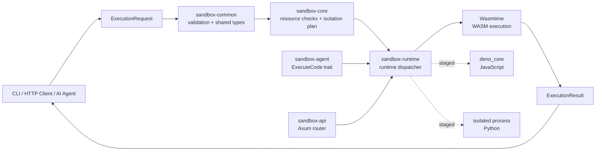

# CortexEnv

**CortexEnv** is a Rust workspace for building a secure, observable execution environment for AI-generated and user-submitted code. It is designed around a fail-closed security model: requests are validated first, network access is denied by default, resource limits are explicit, and each language runtime is isolated behind a focused adapter.

> **Current status:** Phase 1 is implemented as a working foundation. WASM execution, shared request/result types, bounded limits, the Axum API router, the agent execution trait, and the CLI smoke test are available. Linux namespaces, cgroups, seccomp, capability dropping, filesystem isolation, and production authentication are planned hardening work and are not yet complete.

Repository: <https://github.com/hidecard/CortexEnv>

## What CortexEnv does

The project accepts an execution request containing a language, program payload, resource limits, and a network policy. The request is validated by `sandbox-common` and `sandbox-core`. The selected runtime then executes the program and returns a structured result containing an ID, exit status, stdout, stderr, timeout state, duration, and completion timestamp.

In the current Phase 1 implementation, the working runtime is WebAssembly through Wasmtime. The CLI accepts a hexadecimal WASM module, while the API exposes a reusable Axum router for synchronous execution. JavaScript and Python are represented as staged runtime targets and currently fail closed with an unsupported-language error.

## Architecture



### Execution flow

1. A client creates an `ExecutionRequest` with a UUID, language, source/module payload, resource limits, and network policy.
2. `sandbox-common` rejects empty or oversized code and validates timeout, memory, process, file-descriptor, and output ceilings.
3. `sandbox-core` creates an explicit isolation plan. The default plan is network-disabled and does not silently broaden permissions.
4. `sandbox-runtime` dispatches to the selected runtime. WASM bytes are currently supplied as hexadecimal text and loaded into Wasmtime.
5. The runtime invokes the module's `_start` export when present and returns a structured `ExecutionResult`.
6. The API or CLI serializes the result as JSON for the caller.

## Workspace layout

| Component | Responsibility |
| --- | --- |
| `sandbox-common` | Shared request/result/configuration types, errors, language and network policy enums, and bounded resource validation. |
| `sandbox-core` | Execution validation, tracing hook, and the fail-closed isolation plan that will later connect to namespaces, cgroups, seccomp, and capability controls. |
| `sandbox-runtime` | Runtime dispatch and Wasmtime WASM execution. JavaScript and Python adapters are staged for later phases. |
| `sandbox-api` | Axum router with `GET /health` and `POST /v1/execute`. |
| `sandbox-agent` | Provider-neutral async `ExecuteCode` trait for AI agents and future self-healing loops. |
| `sandbox-cli` | Local command-line runner, distributed as the `cortexenv` executable. |
| `CortexEnv` root crate | Workspace marker and project metadata. |

## Requirements

- Rust stable and Cargo
- A Linux environment is recommended for the planned namespace/cgroup/seccomp work
- No system OpenSSL development package is required for the current HTTP client configuration; `reqwest` uses `rustls-tls`

Install Rust if needed:

```bash
curl --proto '=https' --tlsv1.2 -sSf https://sh.rustup.rs | sh
source "$HOME/.cargo/env"
```

## Build and test

From the repository root:

```bash
cargo fmt --all -- --check
cargo test --workspace
```

The test suite currently covers shared default policies, bounded resource validation, and the fail-closed network setting in the core isolation plan. The workspace also runs documentation tests for all crates.

## CLI usage

The `cortexenv` CLI takes a file containing hexadecimal WASM bytes. This minimal empty module is enough to verify loading and execution:

```bash
printf '0061736d01000000' > /tmp/empty.wasm.hex
cargo run -p sandbox-cli --bin cortexenv -- --file /tmp/empty.wasm.hex
```

Expected output is JSON similar to:

```json
{
  "id": "...",
  "exit_code": 0,
  "stdout": "",
  "stderr": "",
  "timed_out": false,
  "duration_ms": 1,
  "completed_at": "2026-11-09T15:57:54Z"
}
```

The CLI supports a custom timeout:

```bash
cargo run -p sandbox-cli --bin cortexenv -- --file /tmp/empty.wasm.hex --timeout-ms 1000
```

## API usage

`sandbox-api` currently exposes a router constructor rather than a standalone server binary. The available routes are:

- `GET /health` returns `ok`.
- `POST /v1/execute` accepts a JSON `ExecutionRequest` and returns an `ExecutionResult` or a `400` error.

A request shape is:

```json
{
  "language": "wasm",
  "code": "0061736d01000000",
  "limits": {
    "timeout_ms": 5000,
    "memory_bytes": 134217728,
    "process_count": 32,
    "file_descriptors": 64,
    "output_bytes": 1048576
  },
  "network": "deny"
}
```

The `id` field is generated automatically when omitted. The language values are `wasm`, `javascript`, and `python`; only `wasm` is executable in the current phase.

## GitHub Actions CI

Every push to `main` and every pull request targeting `main` runs [`.github/workflows/ci.yml`](.github/workflows/ci.yml) on both Ubuntu and Windows.

The Ubuntu job runs the complete workspace test because the sandbox isolation roadmap targets Linux namespaces, cgroups, seccomp, and capability controls. The Windows job checks formatting, builds the portable `cortexenv.exe` release executable, tests the portable `CortexEnv` and `sandbox-common` crates, and uploads the executable as a workflow artifact. This split is intentional: the current isolation dependency set targets Linux, while the CLI and shared contract crate are cross-platform.

To run the same checks locally on Windows PowerShell after installing Rust stable and Visual Studio C++ Build Tools:

```powershell
cargo fmt --all -- --check
cargo build -p sandbox-cli --bin cortexenv --release
cargo test -p CortexEnv -p sandbox-common
```

## Distributable binaries

The CLI binary is named `cortexenv`. GitHub Actions builds a Windows executable and a Debian package whenever a version tag such as `v0.1.0` is pushed. The release workflow is [`.github/workflows/release.yml`](.github/workflows/release.yml) and publishes the artifacts to a GitHub Release for version tags.

### Build the Windows `.exe`

On Windows PowerShell:

```powershell
cargo build -p sandbox-cli --bin cortexenv --release
```

The executable is created at:

```text
target\release\cortexenv.exe
```

Run it with a hex-encoded WASM module:

```powershell
.\target\release\cortexenv.exe --file .\empty.wasm.hex
```

### Build the Linux `.deb`

On Debian/Ubuntu or WSL2 Ubuntu:

```bash
cargo install cargo-deb --locked
cargo build -p sandbox-cli --bin cortexenv --release
cargo deb -p sandbox-cli --no-build
```

The package is written to `target/debian/` and installs the command as `/usr/bin/cortexenv`. Install it with:

```bash
sudo apt install ./target/debian/cortexenv_*.deb
cortexenv --help
```

To publish both artifacts automatically, create and push a version tag:

```bash
git tag v0.1.0
git push origin v0.1.0
```

The tag workflow builds `cortexenv-windows-x86_64.exe`, builds the Debian `amd64` package, and creates a GitHub Release with both files attached.

## Security model and limitations

CortexEnv intentionally does not claim to be a production hostile-code boundary yet. The current implementation provides policy types and validation, but the following controls still need to be implemented and tested before production use:

- PID, mount, network, UTS, IPC, and user namespaces
- cgroup CPU, memory, process, and file-descriptor enforcement
- seccomp syscall filtering and capability dropping
- temporary per-execution filesystems, traversal protection, and cleanup
- rootless operation and loopback-only network policy enforcement
- process supervision, hard kill on timeout, and output backpressure
- API key/JWT authentication, quotas, rate limiting, and tenant isolation
- Prometheus/OpenTelemetry instrumentation and production deployment images

Never execute untrusted hostile code with elevated privileges using the current Phase 1 implementation. Treat the current `IsolationPlan` as a design boundary and validation layer, not as proof that the operating-system isolation controls are already active.

## Development roadmap

The roadmap is tracked in [`TODO.md`](TODO.md). The next recommended step is to implement a real Linux supervisor in `sandbox-core`: create a per-execution workspace, apply cgroup limits, configure namespaces and seccomp, drop capabilities, supervise the child process, and add integration tests for fork bombs, memory exhaustion, path traversal, syscall escape attempts, and network escape.

## License

MIT. See [`LICENSE`](LICENSE).
